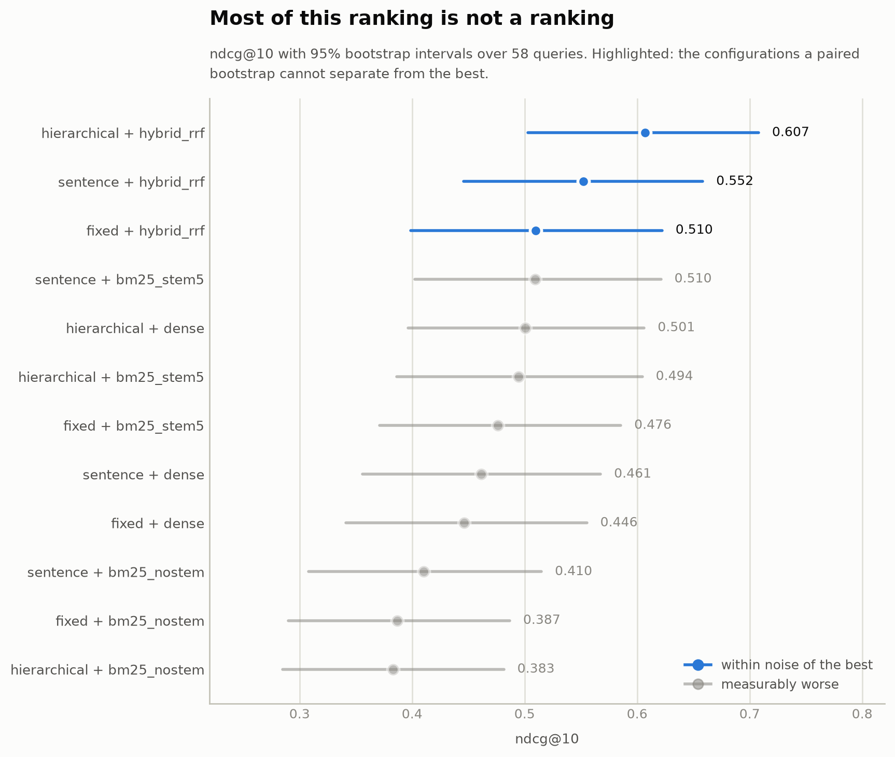
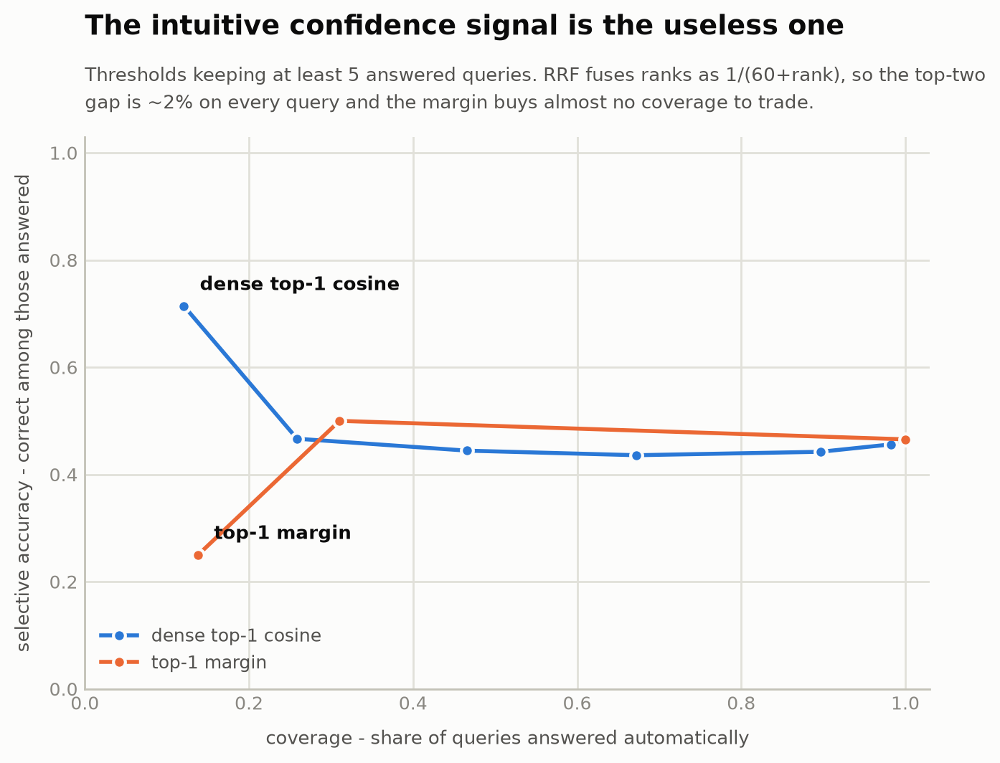

# turkish-rag-eval

[](https://pypi.org/project/turkish-rag-eval/)
[](https://github.com/RizgarOzan/turkish-rag-eval/actions/workflows/validate.yml)
[](https://github.com/RizgarOzan/turkish-rag-eval/blob/main/NOTICE.md)
[](https://huggingface.co/datasets/RizgarOzan/turkish-rag-eval)

A benchmark and CLI for retrieval in Turkish RAG pipelines. It compares three
chunking strategies, four retrievers and six embedding models on a
hand-labelled Turkish gold set, with confidence intervals and query cost, and
runs the same comparison on your own documents.

```bash
pip install turkish-rag-eval
turkish-rag-eval run --corpus ./belgelerim --gold ./sorular.json
turkish-rag-eval report
```

<picture>
  <source media="(prefers-color-scheme: dark)" srcset="https://raw.githubusercontent.com/RizgarOzan/turkish-rag-eval/main/docs/media/ask-q034-dark.gif">
  
</picture>

One question, four retrievers: only the hybrid finds the symptoms section of
the right article ([the transcript](https://github.com/RizgarOzan/turkish-rag-eval/blob/main/docs/usage.md#one-question-at-a-time)).

## What it found

1. The embedding model matters more than any pipeline choice. Every model
   trained for retrieval beats stemmed BM25 (0.494) on its own, and the best,
   [Mursit-Large-TR-Retrieval](https://huggingface.co/newmindai/Mursit-Large-TR-Retrieval),
   reaches 0.781 nDCG@10 on hierarchical chunks. A small E5 the same size as
   the default goes from 0.501 to 0.642 with nothing else changed, at about
   the same speed (22 ms against 23 ms).

2. Turkish stemming is the cheapest real win. Cutting tokens to a 5-character
   prefix before BM25 lifts nDCG@10 by 23 to 29% on every chunking strategy,
   and a paired bootstrap puts every gain clear of zero (`hierarchical +0.111,
   95% CI [+0.026, +0.204]`). "diyabet", "diyabetin", "diyabete" and
   "diyabetli" are one concept; an unstemmed index rarely matches the form the
   query used.

3. The top of the table is a tie, so cost decides. With 58 queries a paired
   bootstrap cannot separate the best configuration from the other two hybrid
   ones; the remaining nine are measurably worse. `sentence + hybrid_rrf`
   gives the same quality at 27 ms instead of 37 ms.

<picture>
  <source media="(prefers-color-scheme: dark)" srcset="https://raw.githubusercontent.com/RizgarOzan/turkish-rag-eval/main/docs/charts/ndcg-intervals-dark.png">
  
</picture>

4. The obvious confidence signal does not work. For deciding when not to
   answer, the gap between the top two hits does worse than answering
   everything (0.25 selective accuracy against a 0.47 baseline). RRF fuses
   ranks as `1/(60+rank)`, so that gap is about 2% on every query. The dense
   retriever's raw cosine works as a signal.

<picture>
  <source media="(prefers-color-scheme: dark)" srcset="https://raw.githubusercontent.com/RizgarOzan/turkish-rag-eval/main/docs/charts/abstention-dark.png">
  
</picture>

5. How a question is typed can cost more than the model choice. In capitals
   the default model's nDCG@10 falls from 0.501 to 0.051, more than the 0.280
   between it and the best model. Without Turkish letters ("sigara icmek"),
   stemmed BM25 drops from 0.494 to 0.288, and even Mursit loses 0.142 in
   capitals. A small normaliser that restores Turkish letters from the
   corpus's own words and lowercases the Turkish way recovers most of it (BM25
   0.288 → 0.477) and leaves correctly typed questions alone.

Longer write-up of the first result:
[English](https://github.com/RizgarOzan/turkish-rag-eval/blob/main/docs/blog/2026-09-19-bm25-turkish-en.md) ·
[Türkçe](https://github.com/RizgarOzan/turkish-rag-eval/blob/main/docs/blog/2026-09-19-bm25-turkish-tr.md).

## Results

58 queries, default embedding model `paraphrase-multilingual-MiniLM-L12-v2`,
CPU only. Intervals are 95% bootstrap over queries; `turkish-rag-eval report`
regenerates this table.

| Chunking | Retriever | nDCG@10 | 95% CI | R@5 | MRR | P95 |
|---|---|---|---|---|---|---|
| **hierarchical** | **hybrid_rrf** | **0.613** | [0.508, 0.716] | 0.690 | 0.559 | 37 ms |
| sentence | hybrid_rrf | 0.558 | [0.453, 0.662] | 0.621 | 0.500 | 27 ms |
| fixed | hybrid_rrf | 0.517 | [0.404, 0.629] | 0.578 | 0.484 | 31 ms |
| sentence | bm25_stem5 | 0.510 | [0.403, 0.621] | 0.638 | 0.462 | 4 ms |
| hierarchical | dense | 0.501 | [0.396, 0.606] | 0.569 | 0.441 | 30 ms |
| hierarchical | bm25_stem5 | 0.494 | [0.386, 0.605] | 0.569 | 0.444 | 8 ms |
| fixed | bm25_stem5 | 0.476 | [0.371, 0.585] | 0.526 | 0.421 | 4 ms |
| sentence | dense | 0.461 | [0.356, 0.567] | 0.552 | 0.410 | 21 ms |
| fixed | dense | 0.446 | [0.341, 0.555] | 0.491 | 0.402 | 25 ms |
| sentence | bm25_nostem | 0.411 | [0.308, 0.515] | 0.483 | 0.356 | 4 ms |
| fixed | bm25_nostem | 0.387 | [0.290, 0.487] | 0.414 | 0.319 | 3 ms |
| hierarchical | bm25_nostem | 0.383 | [0.285, 0.482] | 0.500 | 0.319 | 6 ms |

Everything else measured so far is in
[docs/results.md](https://github.com/RizgarOzan/turkish-rag-eval/blob/main/docs/results.md):
the model leaderboard with paired intervals, groundedness of five generators,
the stem-length and chunk-size sweeps, reranking, the stress test, int8, GPU
and ONNX timings, and the `serve` load test. Tests rebuild every table there
from the committed files in `results/`.

## Why not an existing benchmark?

MTEB-style retrieval benchmarks, TR-MTEB included, score an embedding model on
passages that are already split. They tell you which model to pick. They don't
tell you which chunker to use, whether Turkish stemming is worth it, whether a
hybrid helps, or what each costs on a CPU. This harness keeps the articles
whole, lets every chunker cut them its own way, and judges each chunk by the
answer span, so pipeline choices are compared on the same labels. For a
model-only comparison the same data exports to the BEIR layout MTEB reads
(`turkish-rag-eval export-hf`), published as
[RizgarOzan/turkish-rag-eval](https://huggingface.co/datasets/RizgarOzan/turkish-rag-eval);
adding it to MTEB is proposed in
[embeddings-benchmark/mteb#5536](https://github.com/embeddings-benchmark/mteb/issues/5536).

## Install

Python 3.10+, CPU is enough.

```bash
pip install turkish-rag-eval          # metrics, BM25, gold-set tooling
pip install 'turkish-rag-eval[all]'   # + dense retrieval, charts, LLM commands
```

PyPI still has v0.2.0, which predates `ask`, `serve`, `stress`,
`run --normalize` and `run --embedding-cache` (see the
[changelog](https://github.com/RizgarOzan/turkish-rag-eval/blob/main/CHANGELOG.md)).
Until 0.3.0 is out, install from GitHub to get them:
`pip install 'turkish-rag-eval[all] @ git+https://github.com/RizgarOzan/turkish-rag-eval'`.

## Commands

| Command | What it does |
|---|---|
| `run` | every chunking × retriever combination; writes `results/` |
| `ask` | one question, every retriever's top chunks side by side |
| `serve` | BM25 or hybrid search over HTTP |
| `report` | intervals, paired comparisons, and a recommendation |
| `charts` | the two figures above, light and dark |
| `leaderboard` | rebuild the model table; `--check` verifies every entry |
| `stress` | the gold questions typed without Turkish letters, in caps, and through `str.lower()` |
| `abstain` | coverage / selective-accuracy curve for the best configuration |
| `abstain-report` | re-print the coverage curve from saved `abstain` records |
| `groundedness` | score the generation half against the gold spans |
| `bootstrap` | draft a gold set for your own corpus |
| `agreement` | inter-annotator agreement over the gold set |
| `fetch-corpus` | `--verify` checks the committed snapshot against its lock; without it, refetch live Wikipedia and report drift; `--include-drafts` for all 300 questions |
| `export-hf` | the BEIR layout MTEB reads |
| `validate` | every gold file's invariants |

[docs/usage.md](https://github.com/RizgarOzan/turkish-rag-eval/blob/main/docs/usage.md)
covers running from a checkout, other embedding models, the embedding cache,
your own corpus and drafting questions for it, and `ask` and `serve`.
`turkish-rag-eval <command> --help` lists each command's options. Design
choices behind the metrics are in
[docs/design.md](https://github.com/RizgarOzan/turkish-rag-eval/blob/main/docs/design.md).

## Gold set

58 health questions, labelled by one person, over 54 Turkish Wikipedia
articles (1.09 M characters; 27 answer at least one question, the other 27 are
distractors from the same domain). All published numbers come from these.

Another 242 questions in history, geography, astronomy, biology and computing
were drafted by an LLM and labelled twice by two independent LLM passes. They
stay out of the results until people have reviewed them. Batch history,
agreement figures and a first run on all 300 are in
[docs/gold-set.md](https://github.com/RizgarOzan/turkish-rag-eval/blob/main/docs/gold-set.md).

## Status

v0.2.0 is [on PyPI](https://pypi.org/project/turkish-rag-eval/); `main` is
ahead of it (see [Install](#install)). The retrieval harness, `groundedness`
on the 58 human questions, `report`, `ask`, `serve`, `stress`,
`leaderboard --check`, `bootstrap`, `agreement`, the Hugging Face export and
scoring all 300 questions on a pinned corpus all work, and CI validates every
contributed question against live Wikipedia.

In progress: human review of the 242 drafted questions. Issues labelled
[`human-review`](https://github.com/RizgarOzan/turkish-rag-eval/labels/human-review)
hand out about ten drafts each; `turkish-rag-eval validate` counts how many
are done. Not yet done: EmbeddingGemma, and `groundedness` on the drafted
questions.

## Limits

- 58 queries is a small set. The intervals show how wide that is; most of the
  table's ordering is not resolved by this much data.
- The 58 human questions have one annotator, so they have no agreement figure.
  The 242 drafts are double-labelled, but by two LLM passes, not two people.
- The corpus is Wikipedia, and so is much of the training data. Every
  embedding model ranked here was almost certainly trained on Turkish
  Wikipedia, so absolute scores are optimistic; what this measures is the
  comparison between pipeline choices on the same corpus. A non-Wikipedia
  domain is the most useful thing a contributor could add.
- Six embedding models, one corpus. `bge-m3` is a partial run and
  EmbeddingGemma is missing. `abstain` uses only the default model.
- Encyclopaedic text, not clinical text. Nothing here transfers to a clinical
  setting without re-measurement. No patient data is used anywhere, and
  nothing here is a medical device.
- Groundedness was measured once, through hosted APIs, on the human set only;
  the judge was checked by hand on 16 verdicts.
- The embedding model is pinned by name, not by revision.

## Contribute

Adding questions needs no ML background: pick a Turkish Wikipedia article,
write 5 to 10 paraphrased questions, and open a pull request with one JSON
file. A validator checks each file against Wikipedia in CI. Smaller still,
each [`human-review`](https://github.com/RizgarOzan/turkish-rag-eval/labels/human-review)
issue lists ten drafted questions to check against their article, and marking
them `ok`, `fixed` or `rejected` is the whole job. Submitting an embedding
model is one command and a pull request
([how](https://github.com/RizgarOzan/turkish-rag-eval/blob/main/docs/usage.md#choosing-a-model)).
See [CONTRIBUTING.md](https://github.com/RizgarOzan/turkish-rag-eval/blob/main/CONTRIBUTING.md)
(Türkçe açıklama dahil) and the
[good first issues](https://github.com/RizgarOzan/turkish-rag-eval/issues?q=is%3Aopen+label%3A%22good+first+issue%22).

Contributors so far: [@KonstantinBurkin](https://github.com/KonstantinBurkin)
(the `agreement` script, [#14](https://github.com/RizgarOzan/turkish-rag-eval/pull/14))
and [@eyupcodes](https://github.com/eyupcodes) (sentence splitting after
initials, [#29](https://github.com/RizgarOzan/turkish-rag-eval/pull/29);
`agreement --include-drafts`, [#30](https://github.com/RizgarOzan/turkish-rag-eval/pull/30)).

## Licence

Code MIT ([LICENSE](https://github.com/RizgarOzan/turkish-rag-eval/blob/main/LICENSE)).
Data under `data/` is Turkish Wikipedia, CC BY-SA 4.0
([NOTICE.md](https://github.com/RizgarOzan/turkish-rag-eval/blob/main/NOTICE.md)).
